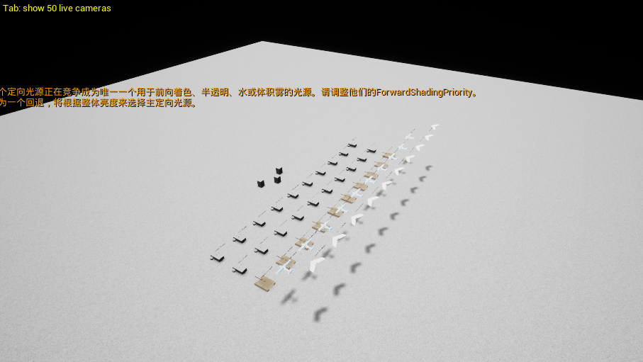

# 四类平台参数指标  
与 Gazebo 实现详尽调研

## 公开数据  实现机制  配置位置  验证方法

__核心结论：__旧演示场景的50路cmd\_vel仅说明速度接口。新增方案提出多实例、采集与同步目标，尚无实际参数或达标证据。公开数值继续作为参考；新平台适用范围、交付边界及验证要求见第12至15章。

| 类型 | 场景数量与编号 | 说明记载的控制方式 |
| --- | --- | --- |
| UGV 无人车 | 20 台 01–20 | 文件记载为差速驱动 |
| TANK 坦克 | 10 台 21–30 | 履带外观与差速轮驱动代理 |
| PLANE 常规固定翼 | 10 台 31–40 | 关闭重力与直接速度控制 |
| WING Zephyr 飞翼 | 10 台 41–50 | 关闭重力与直接速度控制 |

场景截图。外观和阵列可用于展示

# 1 从 cmd\_vel 到运动的完整链路

控制链路为 ROS 2 发布器 → ros\_gz\_bridge 消息转换 → Gazebo Transport 话题 → 运动插件 → 物理或速度更新 → 位姿反馈 → UE 显示。桥接负责传递消息，具体运动行为由下游插件决定。\[1–2\]

| 字段 | 单位 | 当前约定与边界 |
| --- | --- | --- |
| linear.x | m/s | 地面前后移动；飞机代理简化前后移动 |
| angular.z | rad/s | 地面转向；飞机代理简化偏航 |
| linear.z | m/s | 仅飞机代理的简化升降 |
| 其他三个分量 | m/s 或 rad/s | 当前说明未开放使用，不能据消息结构推断已实现 |
| 消息未携带的内容 | — | 目标点、持续时间、时间戳、坐标系、载荷、续航、平台型号 |

Twist 只有 linear 和 angular 两个三维向量，没有 Header。坐标系与命令是否超时必须由接口约定和接收端实现。ROS 常用 SI 单位及机体 X 前、Y 左、Z 上约定，但不能据此跳过模型自身坐标变换检查。\[1,3\]

## 话题与模型的绑定

旧场景四类均使用/rover\_XX/cmd\_vel，名称不表示平台类型。默认话题与该名称的映射须由插件或桥接落实。\[8,13\] 新方案存在多个独立实例，须由Bridge明确实例身份、机器人编号与隔离映射，不能默认原编号全局唯一。

## 桥接配置应检查什么

\# 说明性 YAML 片段  字段支持以所用 ros\_gz 版本为准  
\- ros\_topic\_name: /rover\_01/cmd\_vel  
  gz\_topic\_name: /rover\_01/cmd\_vel  
  ros\_type\_name: geometry\_msgs/msg/Twist  
  gz\_type\_name: ignition.msgs.Twist  
  direction: ROS\_TO\_GZ

依据链接  [\[1\] ROS 2 Humble Twist 消息定义](https://github.com/ros2/common\_interfaces/blob/humble/geometry\_msgs/msg/Twist.msg)  [\[2\] ros\_gz\_bridge Humble 消息映射与配置](https://github.com/gazebosim/ros\_gz/blob/humble/ros\_gz\_bridge/README.md)  [\[3\] ROS REP 103 单位与坐标约定](https://github.com/ros\-infrastructure/rep/blob/master/rep\-0103.rst)  [\[8\] Gazebo Sim 8 DiffDrive 参数接口](https://gazebosim.org/api/sim/8/classgz\_1\_1sim\_1\_1systems\_1\_1DiffDrive.html)  [\[13\] Gazebo Sim 8 VelocityControl 参数接口](https://gazebosim.org/api/sim/8/classgz\_1\_1sim\_1\_1systems\_1\_1VelocityControl.html)  

# 2 尺寸 质量 惯量与载荷怎样生效

Gazebo 通用物理描述以 SDF 为基础。一个 model 可以有多个 link；每个 link 分别具有惯性、视觉、碰撞及传感器属性。展示外形、接触形状和运动控制相互关联，但需要分别配置。\[4–7\]

| 指标 | 配置位置 | 实现含义与核对方式 |
| --- | --- | --- |
| 长宽高 m | visual/geometry collision/geometry | 视觉影响外观，碰撞体影响接触；两者尺寸都要检查 |
| 质量 kg | link/inertial/mass | 每个 link 的质量；整机应统计全部 link 及 include 模型 |
| 重心 m | link/inertial/pose | 质心位置及惯性坐标朝向；改变载荷位置会改变重心 |
| 惯量 kg·m² | link/inertial/inertia | ixx、iyy、izz 与交叉项；控制转动响应，不是质量的替代值 |
| 重力 | link/gravity 世界重力 | false 会移除该 link 的重力影响；不能再据静止判断升力平衡 |
| 接触摩擦 | collision/surface | 摩擦方向与滑移受物理后端支持影响，不能只检查数值存在 |
| 实际载荷 kg | 新增 payload link 固定 joint 或合并惯性 | 物理质量、碰撞与重心共同变化；额定载荷上限另由逻辑校验 |

依据链接  [\[4\] SDF 1.9 Link 定义](https://github.com/gazebosim/sdformat/blob/sdf12/sdf/1.9/link.sdf)  [\[5\] SDF 1.9 惯性与重心定义](https://github.com/gazebosim/sdformat/blob/sdf12/sdf/1.9/inertial.sdf)  [\[6\] SDF 1.9 Joint 限制与阻尼定义](https://github.com/gazebosim/sdformat/blob/sdf12/sdf/1.9/joint.sdf)  [\[7\] SDF 1.9 Surface 接触与摩擦定义](https://github.com/gazebosim/sdformat/blob/sdf12/sdf/1.9/surface.sdf)  

# 3 无人车 UGV 的速度与转向实现

按提供文件，UGV 为差速驱动。Gazebo DiffDrive 读取线速度 v 和偏航角速度 ω，根据轮半径 r、左右轮间距 b 生成左右轮关节速度，再由接触与物理引擎更新车辆运动。\[8–9\]

左轮角速度 = (v \- ω·b/2) / r  
右轮角速度 = (v \+ ω·b/2) / r

| 指标 | DiffDrive 字段 | 解释 |
| --- | --- | --- |
| 轮半径 m | wheel_radius | 换算线速度与轮转速，必须匹配几何 |
| 轮间距 m | wheel_separation | 左右轮中心距，影响转弯比例 |
| 轮关节名称 | left_joint / right_joint | 可重复配置，分别绑定两侧车轮 |
| 前后速度 m/s | min_linear_velocity max_linear_velocity | 显式限制前后行驶命令 |
| 转向速度 rad/s | min_angular_velocity max_angular_velocity | 与线速度分别设置 |
| 加减速度 | min_linear_acceleration max_linear_acceleration | 线加速度单位 m/s²；角加速度另用 angular 字段 |
| 速度变化平滑度 | min_linear_jerk max_linear_jerk | 加加速度限制；不是电机力矩模型 |
| 里程计频率 Hz | odom_publish_frequency | 控制发布频率，不等于物理更新频率 |

## 限速与驱动力并不等价

DiffDrive 源码对指令限幅后写入 JointVelocityCmd。max\_linear\_acceleration 可以让命令逐步增加，但不会自动辨识车辆电机功率、传动效率或满载加速性能。要研究这些物理限制，须核对关节 effort、velocity、驱动控制方式与物理后端。\[6,9\]

避免只用 max\_velocity：此通用字段同时影响线速度和角速度，单位语义不同。优先使用明确的 linear 与 angular 字段，并分别设置负向速度及减速度。\[8\]

## 建议如何验证

在无接触干扰的平地上比较阶跃命令与模型真实速度；再做定速圆周和停止测试。用 Gazebo 真实位姿计算轨迹，并与轮式里程计分别记录。滑移时两者可能不同，不能只读 cmd\_vel 就宣布达到速度。

依据链接  [\[8\] Gazebo Sim 8 DiffDrive 参数接口](https://gazebosim.org/api/sim/8/classgz\_1\_1sim\_1\_1systems\_1\_1DiffDrive.html)  [\[9\] gz\-sim8 DiffDrive 实现源码](https://github.com/gazebosim/gz\-sim/blob/gz\-sim8/src/systems/diff\_drive/DiffDrive.cc)  [\[6\] SDF 1.9 Joint 限制与阻尼定义](https://github.com/gazebosim/sdformat/blob/sdf12/sdf/1.9/joint.sdf)  

# 4 坦克与履带平台的指标实现

当前 TANK 使用履带外观加差速轮代理，其速度边界可先用差速插件管理。若需要体现履带接地，应采用 TrackedVehicle 配合每侧 TrackController；仅替换 mesh 不改变驱动原理。\[10–12\]

| 参数 | 配置位置 | 含义 |
| --- | --- | --- |
| 履带绑定 | TrackedVehicle left_track / right_track | 填写各侧 link 及可选速度话题 |
| 履带中心距 m | tracks_separation | 车辆转向几何尺度 |
| 履带高度 m | track_height | 用于里程计计算，不代表全部履带几何 |
| 转向效率 | steering_efficiency | 模型转向近似参数，需通过转弯试验校准 |
| 车体线速度限制 | linear_velocity 子块 | min/max_velocity、acceleration、jerk |
| 车体角速度限制 | angular_velocity 子块 | 字段层级不同于 DiffDrive，不能混抄 |
| 单履带速度限制 | TrackController min/max_velocity 等 | 车体和单侧限制需共同检查 |
| 命令超时 s | TrackController max_command_age | 过期后停该履带；与重复发出的旧车体指令联动仍需测试 |

## 履带插件怎样产生运动

TrackController 在履带与地面接触点设置期望接触面运动，通过摩擦约束近似履带推进。它不是把履带分解成全部链节逐个传动。官方说明其仅支持速度控制，没有 effort 控制，也不模拟履齿效应。\[11\]

## 爬坡 越障与最小转弯半径

最大爬坡角、侧坡、越障高度和跨沟宽度通常是测试结果，并不存在一个填写“max\_slope”就自动实现能力的通用 SDF 字段。要在已定义地形、摩擦、载荷与驱动条件下测试。厂家坡度 60% 等于 tan(坡角)=0.60，约为 31°，不能写为 60°。

可原地转向表示几何上允许小半径运动，不代表在任意地面、任意载荷下都能无滑移转向。若仍使用轮驱代理，应在报告中保留这一近似条件。

依据链接  [\[10\] Gazebo Sim 8 TrackedVehicle 参数接口](https://gazebosim.org/api/sim/8/classgz\_1\_1sim\_1\_1systems\_1\_1TrackedVehicle.html)  [\[11\] TrackController 原理及能力边界](https://gazebosim.org/api/sim/8/classgz\_1\_1sim\_1\_1systems\_1\_1TrackController.html)  [\[12\] gz\-sim8 履带车辆完整示例](https://github.com/gazebosim/gz\-sim/blob/gz\-sim8/examples/worlds/tracked\_vehicle\_simple.sdf)  [\[7\] SDF 1.9 Surface 接触与摩擦定义](https://github.com/gazebosim/sdformat/blob/sdf12/sdf/1.9/surface.sdf)  [\[31\] Milrem 2024 产品目录 印刷页7](https://d3tr2q1wj7u3d5.cloudfront.net/32284/20240611\_MILREM\-Product\-Catalogue\-EN\_web.pdf)  

# 5 当前飞机速度代理怎样实现指标

按提供文件，两类飞机均关闭重力并使用 VelocityControl。该插件接收 Twist 后持续设置模型的线速度和角速度组件；源码未提供与 DiffDrive 相同的速度、加速度限制读取逻辑。\[13–14\]

<\!\-\- Gazebo Sim 8 的说明性片段  不是完整飞机模型 \-\->  
<plugin filename="gz\-sim\-velocity\-control\-system"  
        name="gz::sim::systems::VelocityControl">  
  <topic>/rover\_31/cmd\_vel</topic>  
</plugin>  
<\!\-\- gravity 位于相应 link 中 \-\->  
<gravity>false</gravity>

| 希望表达的指标 | 现有代理的实现办法 | 能证明到哪里 |
| --- | --- | --- |
| 最大前进与倒退速度 | 在统一接收/控制端校验并限幅 | 速度命令边界 |
| 最大爬升与下降率 | 限制约定坐标中的 linear.z | 简化运动边界，非剩余功率性能 |
| 最大偏航角速度 | 限制 angular.z | 偏航速度边界，非真实协调转弯 |
| 加减速度 | 按仿真 dt 限制相邻速度增量 | 规定的速度过渡，非推力辨识 |
| 最小转弯半径 | 在平面近似下联合限制 v 与 ω | R=\|v/ω\|，仅适用非零 ω 的相应运动假设 |
| 高度与区域范围 | 读取带时间戳位姿后检查 | 外部约束，需要控制端实际执行 |
| 巡航与失速 | 可记录参考范围；真实失速需气动 | 速度代理不能证明升力或失速 |

__工程建议：__若希望所有发送方都受约束，应在统一入口集中处理，避免只修改某一个发送脚本。不能在原始 Twist 中“加上”质量或续航；这些属于独立配置与状态。以上为设计建议，未在现有工程实施。

VelocityControl 的 OnCmdVel 保存最新命令，更新循环持续使用该命令。发布器退出不等于接收端自动清零；失联停车、指令有效期和能源耗尽后的禁用都应明确实现并测试。物理固定翼飞行则不能把零速度当作正常停车操作。\[14\]

依据链接  [\[13\] Gazebo Sim 8 VelocityControl 参数接口](https://gazebosim.org/api/sim/8/classgz\_1\_1sim\_1\_1systems\_1\_1VelocityControl.html)  [\[14\] gz\-sim8 VelocityControl 实现源码](https://github.com/gazebosim/gz\-sim/blob/gz\-sim8/src/systems/velocity\_control/VelocityControl.cc)  [\[1\] ROS 2 Humble Twist 消息定义](https://github.com/ros2/common\_interfaces/blob/humble/geometry\_msgs/msg/Twist.msg)  

# 6 常规固定翼的公开物理模型

PX4 的 rc\_cessna 是常规布局固定翼参考，官方提供新 Gazebo 的运行入口。它的模型中同时存在刚体惯性、多个 LiftDrag、舵面位置控制器和推进模型，运动由受力与控制共同产生。\[17–18\]

| 参数 | 公开配置或计算值 | 口径 |
| --- | --- | --- |
| base_link 质量 | 1.5 kg | 主机体 link，不是整机 |
| 整机 link 质量合计 | 约 1.67 kg | 原调研对该 SDF 直接 link/mass 求和，含轮和传感器 |
| 主机体惯量 | Ixx 0.197563 Iyy 0.1458929 Izz 0.1477 kg·m² | 对应 base_link 惯性坐标 |
| 机体碰撞盒 | 0.65×0.08×0.10 m | 碰撞近似，不直接等于整机外形 |
| 翼部碰撞盒 | 0.1×1.0×0.01 m | 碰撞尺寸，不是气动参考翼面积 |
| 气动参数示例 | 某组 area=0.6 m² cla≈4.7528 alpha_stall≈0.33914 rad | 同模型有多组气动面，须逐组解释 |
| 舵角示例 | rudder_joint 约 -0.78 至 +0.78 rad | 关节行程，不是偏航速度上限 |

## 空气动力怎样进入 Gazebo

LiftDrag 根据 link 相对空气的运动计算迎角和动压，再计算升力与阻力并作用到指定 cp。其基本关系为 q=ρV²/2、L=qSCL、D=qSCD；迎角跨过 alpha\_stall 后使用另一段系数斜率。\[15–16\]

质量决定重量和惯性；翼面积、气动系数、推力及舵面影响飞行响应。巡航空速、爬升率与转弯半径一般要在给定载荷和环境下通过配平或飞行测试得到，不能从 Twist 字段直接读出。

## 如何与现有接口衔接

物理飞行需要控制器把期望运动转成油门与舵面指令。保留 cmd\_vel 作为上层接口是可选设计，但需要新定义控制语义、坐标系和可实现范围；不能把原速度代理与气动插件同时当作同一刚体的独立运动主控。

依据链接  [\[17\] PX4 rc\_cessna 完整 SDF](https://github.com/PX4/PX4\-gazebo\-models/blob/main/models/rc\_cessna/model.sdf)  [\[18\] PX4 新 Gazebo 支持的机型](https://docs.px4.io/main/en/sim\_gazebo\_gz/vehicles)  [\[15\] Gazebo Sim 8 LiftDrag 参数接口](https://gazebosim.org/api/sim/8/classgz\_1\_1sim\_1\_1systems\_1\_1LiftDrag.html)  [\[16\] gz\-sim8 LiftDrag 受力计算源码](https://github.com/gazebosim/gz\-sim/blob/gz\-sim8/src/systems/lift\_drag/LiftDrag.cc)  

# 7 Zephyr 飞翼的公开参数与实现

ArduPilot 的 zephyr 基础模型包含机翼、推进器、两片舵面与 IMU link；zephyr\_with\_ardupilot 通过 include 引入它，再增加气动、关节施力与飞控连接。只有外观基础模型不足以构成可控飞行示例。\[19–21\]

| 参数 | 上游数值 | 所在位置或含义 |
| --- | --- | --- |
| 主翼质量 | 1.5 kg | zephyr 的 wing link |
| 整机 link 质量合计 | 1.90 kg | 1.5+0.05+0.10+0.10+0.15，原调研求和 |
| 主翼重心 pose | 0 -0.12 0 0 0 0 | wing 的 inertial/pose，按该 link 坐标解释 |
| 主翼惯量 | 0.083137104 / 0.387382402 / 0.469845106 kg·m² | 依次为 Ixx、Iyy、Izz |
| 主翼气动参考面积 | 0.50 m² | 扩展模型中的主翼一组插件 |
| 主翼升力斜率 | cla=3.7 | 失速前模型系数，不是固定升力 |
| 主翼失速迎角 | 0.3391428111 rad 约 19.43° | 不是失速空速 |
| 空气密度 | 1.2041 kg/m³ | 该气动插件的 air_density |
| 主翼压力中心 | 0 -0.1 0 m | cp；受力位置与质心不同 |
| 前向与升力方向 | forward: 0 -1 0 upward: 0 0 1 | 方向定义在模型 link 坐标中 |

## 飞翼和常规布局的差别怎样体现

区别应通过几何、质量分布、气动面位置、控制舵面及混控关系体现。Zephyr 左右舵面分别绑定控制关节，并影响局部气动；相同或差动舵面输入产生的响应应由模型与飞控闭环验证，不能仅靠类型标签区分。

当前文件用 linear.x 表示前进，而上游 Zephyr 的气动前向为 \-Y，必须核对 include 的姿态变换与 link 坐标。这里名称一致仅说明有合适候选来源，不能证明现有 WING 已采用这些数值。

__参数读取边界：__多个气动插件的 area 对应不同面和力模型，不能机械相加后宣称获得真实翼面积；修改几何或载荷后，也不能继续默认原气动与控制参数有效。

依据链接  [\[19\] ArduPilot Zephyr 基础模型 SDF](https://github.com/ArduPilot/ardupilot\_gazebo/blob/main/models/zephyr/model.sdf)  [\[20\] Zephyr 气动与飞控扩展 SDF](https://github.com/ArduPilot/ardupilot\_gazebo/blob/main/models/zephyr\_with\_ardupilot/model.sdf)  [\[21\] ArduPilot SITL 与 Gazebo 官方接入](https://ardupilot.org/dev/docs/sitl\-with\-gazebo.html)  

# 8 续航 能耗与能源耗尽的实现

续航是能源容量、功率消耗和工况共同作用的结果。Gazebo 的 LinearBatteryPlugin 可跟踪电荷、端电压和荷电状态；仅填写“续航 3 小时”不会自动生成电机消耗规律。\[22–24\]

| 字段 | 单位 | 用途 |
| --- | --- | --- |
| battery_name | 字符串 | 电池标识，供消费者关联 |
| voltage | V | 初始电压 |
| capacity / initial_charge | Ah | 容量及初始电荷；Ah 不是 Wh |
| power_load | W | 基础功率负载，不自动等于车辆机械功率 |
| resistance | Ω | 内阻与端电压变化 |
| open_circuit_voltage 系数 | V 等 | 按插件模型描述开路电压变化 |
| start_draining | 布尔 | 源码支持的启动耗电参数 |
| BatteryPowerLoad | 运行时组件 | 其他消费者把附加功率汇入同一电池 |

## 恒功率近似与工况

理想恒电压、恒功率条件下，E≈U×C，单位 Wh；T≈E/P，单位 h。Husky A200 手册列 24 V、20 Ah、平均运行 3 h，可算出名义 480 Wh；480/3≈160 W 只是理想平均值推算，不能写成厂家实测恒定功率或实际可用能量。\[24,32\]

若要体现速度、坡度、载荷和传感器对能耗的影响，需要建立相应功率函数或消费者。把所有平台设为同一个固定 power\_load，只能验证固定功耗下的耗电行为，不能据此比较不同平台真实能效。

## 当前速度代理有两个特殊问题

第一，所查电池源码会从关节速度或力命令检测运动并启动耗电；当前飞机用模型速度组件，可能绕过这条触发路径。应显式配置耗电启动并检查 SOC 确实下降。\[23\]

第二，官方教程的耗尽后停机描述针对关节驱动。模型级 VelocityControl 不会因为存在电池就自动获得禁飞或停止逻辑，需要单独验证能源状态是否真正影响该控制链路。\[14,24\]

__版本核对：__API 页存在 start\_drainign 拼写，实际所查源码读取 start\_draining；教程还记录 fix\_issue\_225 的历史耗电倍率问题。应以安装版本源码、示例和测试结果交叉核对，不能机械复制网页字段。\[22–24\]

依据链接  [\[22\] Gazebo LinearBatteryPlugin 参数接口](https://gazebosim.org/api/sim/8/classgz\_1\_1sim\_1\_1systems\_1\_1LinearBatteryPlugin.html)  [\[23\] gz\-sim8 LinearBatteryPlugin 实现源码](https://github.com/gazebosim/gz\-sim/blob/gz\-sim8/src/systems/battery\_plugin/LinearBatteryPlugin.cc)  [\[24\] Gazebo 电池教程与已知限制](https://gazebosim.org/api/sim/8/battery.html)  [\[32\] Clearpath Husky A200 官方手册](https://docs.clearpathrobotics.com/docs\_robots/outdoor\_robots/husky/a200/user\_manual\_husky/)  

# 9 传感器 时间与场景规模指标

“能显示模型”“有 50 路相机”“50 台都能接收命令”分别对应显示、成像和通信。它们不自动证明物理步长、传感器频率、端到端延迟或实时因子达到目标。

| 指标 | Gazebo 配置或测量位置 | 验证口径 |
| --- | --- | --- |
| 相机视场与分辨率 | sensor/camera horizontal_fov、image/width、height | 视场用 rad；渲染结果受安装位姿影响 |
| 相机与传感器频率 | sensor/update_rate | 配置值与实际收到消息的频率分别记录 |
| 相机可见距离 | camera/clip/near、far | 裁剪距离不等于识别距离或目标可探测距离 |
| IMU 定位与激光 | sensor 类型及相应噪声块 | 需要对应系统加载、话题输出和噪声验证 |
| 位姿反馈 | PosePublisher 或已配置输出 | 区分世界真值、里程计及 UE 显示位姿 |
| 物理步长 | physics/max_step_size | 数值积分步长，不等于控制命令周期 |
| 实时因子 RTF | Δ仿真时间 / Δ墙钟时间 | 测实际值，real_time_factor 配置是目标值 |
| 通信与同步误差 | 发送 接收 引擎应用时间戳 | 无 Header 的 Twist 不能独自提供消息时间戳 |

## 截图和当前说明能确认到哪里

旧截图与移动说明记载UE相机输出尚未发布为ROS 2 Image，这只是历史场景状态。新方案要求7类采集数据；来源、消息格式、频率与时间戳须由M5及Bridge逐项确认，不能将目标写成已实现。接口责任见第13章。

## 时间与性能的测试方法

位移应按仿真时间计算。恒速段可用 v≈Δs/Δt\_sim，角速度可用连续解包后的 Δyaw/Δt\_sim；RTF 低于 1 时，墙钟 5 秒并不等于仿真 5 秒。动态轨迹需逐段或积分统计。

旧场景可保留1、10、50台及图像开关的基线测试；新平台还须验证≥20实例、每实例≥50机器人的目标负载。记录RTF、频率、延迟分布及资源占用，区分仿真时间和墙钟时间。新验收目标与证据见第15章；本轮无实测结果。

依据链接  [\[25\] SDF 1.9 Sensor 类型 频率与话题](https://github.com/gazebosim/sdformat/blob/sdf12/sdf/1.9/sensor.sdf)  [\[26\] SDF 1.9 Camera 成像参数](https://github.com/gazebosim/sdformat/blob/sdf12/sdf/1.9/camera.sdf)  [\[27\] SDF 1.9 Physics 时间步定义](https://github.com/gazebosim/sdformat/blob/sdf12/sdf/1.9/physics.sdf)  [\[29\] Gazebo PosePublisher 位姿发布](https://gazebosim.org/api/sim/8/classgz\_1\_1sim\_1\_1systems\_1\_1PosePublisher.html)  [\[35\] Gazebo 官方传感器配置教程](https://gazebosim.org/docs/harmonic/sensors/)  

# 10 公开数值如何选取与统一登记

参数参考应围绕完整型号及版本。地面平台可以选择真实厂家性能表，飞机可以先选公开仿真模型。两者证据等级不同，不能合并成“已验证的平台能力”。

| 参考对象 | 公开数据示例 | 使用限制 |
| --- | --- | --- |
| Leopard 2 A7V [30] | 质量 <69 t；速度 ≤70 km/h； 行驶里程 450 km；宽 3.77–4.00 m | 厂家性能边界，不等于已有配套 Gazebo 模型 |
| THeMIS 2024 [31] | 1650 kg；2.47×2.04×1.17 m； 额定载荷 750 kg；20 km/h； 混动最长 15 h，满载静音最长 1.5 h | 特定履带 UGV 的公开例子，不代表全部无人战车 |
| Husky A200 [32] | 50 kg；0.99×0.67×0.39 m； 最大载荷 75 kg，全地形 20 kg； 最大速度 1 m/s，平均运行 3 h | 通用科研地面平台，具有官方仿真路线 [33] |
| PX4 rc_cessna [17] | 直接 link 质量合计约 1.67 kg； 有惯性、气动、舵面与推进配置 | 仿真模型配置，不是实装性能承诺 |
| ArduPilot Zephyr [19–20] | 直接 link 质量合计 1.90 kg； 主翼气动组 area=0.50 m² | 和当前场景是否同源待核对 |

## 建议的一条参数记录

platform\_type: UGV  
parameter: max\_forward\_speed  
value: null  
unit: m/s  
status: unknown  
source\_url: null  
model\_version: unknown  
implementation: DiffDrive/max\_linear\_velocity  
verification: pending

null 表示未知，不表示 0。每条参数应另附工况和来源版本；例如空载还是满载、道路还是越野、空速还是地速、额定还是最大。公开资料没有给出的加速度、惯量、续航函数，不应拿任意数值补成“真实参数”。

旧说明可登记四类、编号、话题及所述控制方式；实际参数仍待工程证据。新文件未给出替换公开数值的新实测参数。登记时增加配置版本、实例和轮次关联，并区分配置基准、随机化设置及当轮生效值，见第14章。

依据链接  [\[30\] KNDS Leopard 2 A7V 公开性能表](https://knds.com/en/products/systems/leopard/leopard\-2\-a7)  [\[31\] Milrem 2024 产品目录 印刷页7](https://d3tr2q1wj7u3d5.cloudfront.net/32284/20240611\_MILREM\-Product\-Catalogue\-EN\_web.pdf)  [\[32\] Clearpath Husky A200 官方手册](https://docs.clearpathrobotics.com/docs\_robots/outdoor\_robots/husky/a200/user\_manual\_husky/)  [\[33\] Clearpath 官方 Gazebo 仿真概览](https://docs.clearpathrobotics.com/docs/ros/tutorials/simulator/overview/)  [\[17\] PX4 rc\_cessna 完整 SDF](https://github.com/PX4/PX4\-gazebo\-models/blob/main/models/rc\_cessna/model.sdf)  [\[19\] ArduPilot Zephyr 基础模型 SDF](https://github.com/ArduPilot/ardupilot\_gazebo/blob/main/models/zephyr/model.sdf)  

# 11 只读核对与验证清单

目前不需要先补齐全部真实参数。可从现有工程提取可观察信息，明确每项指标已配置、已生效还是仅有参考。下面命令用于已启动且环境一致的 WSL/ROS 2 终端，不修改依赖或发移动命令。

\# 环境与话题  若某条命令不存在则记录实际版本  
printenv ROS\_DISTRO  
ros2 pkg prefix ros\_gz\_bridge  
ros2 topic list \-t  
ros2 topic info /rover\_31/cmd\_vel \-v  
ros2 topic echo /rover\_31/cmd\_vel  
ros2 topic echo /model/rover\_31/pose  
\# Gazebo 新旧命名各查适用的一组  
gz sim \-\-versions  
ign gazebo \-\-versions  
gz topic \-l  
ign topic \-l

ros2 topic echo 会持续监听，按 Ctrl\+C 退出。cmd\_vel 没有发布者时无消息是正常情况；位姿话题名称依据提供文件，实际存在性须以 topic list 为准。只读输出可能无法呈现插件全部内部配置，最终仍需生成的 SDF 和启动日志。

| 验证对象 | 需要保留的证据 | 避免误判 |
| --- | --- | --- |
| 配置是否生效 | 生成 SDF、插件加载日志、版本号 | 源模板存在不等于运行场景已使用 |
| 速度与加速度 | 命令序列、真值位姿、仿真时间 | 命令值不等于实际速度 |
| 转向与制动 | 轨迹半径、角速度、停止距离与时间 | 无视滑移和命令延迟 |
| 载荷影响 | 装载量、位置、质量与响应对照 | 仅改标签或容量上限 |
| 续航与停机 | SOC、功率、起止仿真时间、耗尽行为 | 只显示电量但驱动继续运行 |
| 固定翼真实性 | 气动与推进配置、飞控日志、受力响应 | 把关闭重力的升降当作真实爬升 |
| 50 台规模 | RTF、频率、延迟、资源与丢消息 | 只凭截图或发布器数量判断达标 |

建议供方提供按型号版本组织的参数表、字段映射、实际生效配置与验证记录；我方核验约定数据的消费及本层输出。具体模型、能源及执行功能的承接人由平台明确，不能自动归入中间层。责任与证据清单见第13、15章。

依据链接  [\[2\] ros\_gz\_bridge Humble 消息映射与配置](https://github.com/gazebosim/ros\_gz/blob/humble/ros\_gz\_bridge/README.md)  [\[8\] Gazebo Sim 8 DiffDrive 参数接口](https://gazebosim.org/api/sim/8/classgz\_1\_1sim\_1\_1systems\_1\_1DiffDrive.html)  [\[14\] gz\-sim8 VelocityControl 实现源码](https://github.com/gazebosim/gz\-sim/blob/gz\-sim8/src/systems/velocity\_control/VelocityControl.cc)  [\[29\] Gazebo PosePublisher 位姿发布](https://gazebosim.org/api/sim/8/classgz\_1\_1sim\_1\_1systems\_1\_1PosePublisher.html)  [\[34\] Gazebo 与 ROS 发行版配对说明](https://gazebosim.org/docs/harmonic/ros\_installation/)  

# 12 新平台范围 版本与依据

本次更新依据两份新增材料，补充目标、接口与交付口径；原公开参数、模型原理和来源继续保留。新材料没有证明旧条款自动失效，也没有提供四类平台新的实测能力数据。

## 版本与规模需要分别登记

| 事项 | 原调研基准 | 新增材料要求或描述 | 待供方确认 |
| --- | --- | --- | --- |
| 软件环境 | Humble消息与桥接示例；Gazebo Sim 8 API；SDF 1.9说明 | ROS 2 Jazzy；部署包列Ubuntu 24.04 | Gazebo、ros_gz、物理后端与插件的实际版本及兼容清单 |
| 机器人组成 | 单个旧场景50台；20/10/10/10及01至50编号 | ≥20独立实例，每实例≥50机器人 | 实例内类型比例、型号版本及实例间隔离方式 |
| 通信与控制 | 旧cmd_vel和位姿话题说明 | 13类接口；仿真控制、状态、传感器及双引擎连接 | 正式消息、服务、Schema及实例身份映射 |
| 性能目标 | 原场景基线测量建议，未实测 | 复杂场景RTF≥2；UE5同步P99≤100ms | 硬件、场景、传感器负载、并发及测量条件 |

## 旧控制方式保留为历史描述

第1至11章的四类和控制代理来自旧移动说明；新增方案没有逐类声明是否继续采用相同插件。型号、外观、运动控制与物理真实性应分别核对，不能把新平台目标当作旧模型已经升级的证据。

新方案正文中的总体架构图位置为“该类型的内容暂不支持下载”。本次依据可读取的正文和表格审阅，未核对缺失图中的连线与拓扑。

## 新增材料出处

\[新1\]《智能体开发训练平台技术实施方案》：第1章目标与模块；第2章功能；第3.1节接口；第5章验收。文件位于C:/Users/ammo/Desktop/。

\[新2\]《外协内容》：第2至6章模块任务与验收；第7章交付物。文件位于C:/Users/ammo/Desktop/。

本章只确定材料所述目标及待确认项，不认定供方已交付或未交付。

# 13 接口与交付责任

中间层沿用约定边界内的对接与消费职责，对自身输入解析、状态处理和输出留痕负责。平台功能由相应交付方实现；具体承接人和正式接口仍需平台方落实。

| 交付或依赖项 | 责任依据 | 我方对接与核验 |
| --- | --- | --- |
| M1仿真 | 外协清单列入实例管理、恢复与物理随机化注入 | 消费实例状态、时钟和约定参数；识别重启后的轮次 |
| Bridge | 外协清单列入桥接包与DDS配置 | 核对消息、身份、单位、坐标系及状态回传 |
| M2及M3/M4 | 新方案列出；外协清单未列。既定边界由平台落实承接人 | 消费约定场景、配置和必要输出；不默认兜底平台内部集成 |
| M5采集 | 外协清单列入7类采集及数据管理 | 消费约定数据及引用；输出本层必要事件与关联信息 |
| M6显示 | 外协清单列入UE5同步与回放 | 提供约定状态、结果和时戳；联合核对关联 |
| M7部署 | 外协清单列入部署、资源与离线包 | 提供本层依赖、启动与状态说明；配合组件复现 |

# 14 参数生命周期与采集数据

公开参考值继续保留型号、来源和工况。新方案增加域随机化后，还须能还原某个实例、某轮实验实际采用的配置；下表是登记建议，字段名称以正式Schema为准。

| 记录层次 | 需要保存的信息 | 用途与边界 |
| --- | --- | --- |
| 公开参考 | 型号、数值、单位、来源版本、工况 | 说明来源；不能直接充当当前生效值或验收结果 |
| 配置基准 | 模型与配置版本、基准值、适用实例或对象 | 供方生成场景和参数的依据；保留未知项 |
| 随机化设置 | 启用项、范围、分布、采样时机、种子及配置版本 | 由平台定义并确认可用范围；本轮不补造取值 |
| 当轮生效值 | 实例、轮次、实际采样值、仿真起始时间及配置引用 | 参数注入方提供，供采集归档与必要消费 |
| 测量结果 | 运行条件、时间窗口、观测数据与结果引用 | 独立验证执行效果，不用配置值代替实测值 |

## 七类采集数据需要逐项落实

新增材料列出可见光图像、深度图、激光点云、里程计、速度、加速度、力。它们是采集数据类别，不等于每台机器人必须安装七种独立设备；各类平台的必选项、可选项和未提供项仍待明确。

M5与Bridge应逐项给出产生端、消息类型、话题、单位、坐标系、配置频率、实际接收频率、时间戳及归档位置。速度、加速度等需注明来自直接测量还是计算；世界真值、里程计和显示数据分别标识。

# 15 新平台验证与交付证据

| 对象 | 材料所述目标 | 核对条件与证据 |
| --- | --- | --- |
| 实例规模 | ≥20独立实例；每实例≥50机器人 | 实例和模型清单、隔离验证、硬件与负载；区分仿真就绪和训练就绪 |
| 超实时 | 复杂场景RTF≥2 | 场景与配置版本、采集/渲染开关、测量窗口、各实例仿真与墙钟增量及资源占用 |
| UE5同步 | P99≤100ms；外协写连续10分钟 | 明确起止测点、时钟对齐、采样窗口及丢帧；保留延迟原始记录和统计方法 |
| 恢复 | 异常后30秒内自动重启 | 异常注入时刻、重启与可用时刻；区分进程恢复、服务就绪和任务/训练恢复 |
| 采集与回放 | 7类数据采集；归档与时间轴回放 | 逐类样本、实际频率、实例轮次和时间关联、缺失项及回放对照 |
| 随机化 | 每轮参数采样并注入 | 配置、种子、当轮生效值、注入记录及可观察验证；不能只看数值变化 |

# 参考资料一 消息 物理与运动模型

[\[1\] ROS 2 Humble Twist 消息定义](https://github.com/ros2/common\_interfaces/blob/humble/geometry\_msgs/msg/Twist.msg)

[\[2\] ros\_gz\_bridge Humble 消息映射与配置](https://github.com/gazebosim/ros\_gz/blob/humble/ros\_gz\_bridge/README.md)

[\[3\] ROS REP 103 单位与坐标约定](https://github.com/ros\-infrastructure/rep/blob/master/rep\-0103.rst)

[\[4\] SDF 1.9 Link 定义](https://github.com/gazebosim/sdformat/blob/sdf12/sdf/1.9/link.sdf)

[\[5\] SDF 1.9 惯性与重心定义](https://github.com/gazebosim/sdformat/blob/sdf12/sdf/1.9/inertial.sdf)

[\[6\] SDF 1.9 Joint 限制与阻尼定义](https://github.com/gazebosim/sdformat/blob/sdf12/sdf/1.9/joint.sdf)

[\[7\] SDF 1.9 Surface 接触与摩擦定义](https://github.com/gazebosim/sdformat/blob/sdf12/sdf/1.9/surface.sdf)

[\[8\] Gazebo Sim 8 DiffDrive 参数接口](https://gazebosim.org/api/sim/8/classgz\_1\_1sim\_1\_1systems\_1\_1DiffDrive.html)

[\[9\] gz\-sim8 DiffDrive 实现源码](https://github.com/gazebosim/gz\-sim/blob/gz\-sim8/src/systems/diff\_drive/DiffDrive.cc)

[\[10\] Gazebo Sim 8 TrackedVehicle 参数接口](https://gazebosim.org/api/sim/8/classgz\_1\_1sim\_1\_1systems\_1\_1TrackedVehicle.html)

[\[11\] TrackController 原理及能力边界](https://gazebosim.org/api/sim/8/classgz\_1\_1sim\_1\_1systems\_1\_1TrackController.html)

[\[12\] gz\-sim8 履带车辆完整示例](https://github.com/gazebosim/gz\-sim/blob/gz\-sim8/examples/worlds/tracked\_vehicle\_simple.sdf)

[\[13\] Gazebo Sim 8 VelocityControl 参数接口](https://gazebosim.org/api/sim/8/classgz\_1\_1sim\_1\_1systems\_1\_1VelocityControl.html)

[\[14\] gz\-sim8 VelocityControl 实现源码](https://github.com/gazebosim/gz\-sim/blob/gz\-sim8/src/systems/velocity\_control/VelocityControl.cc)

[\[15\] Gazebo Sim 8 LiftDrag 参数接口](https://gazebosim.org/api/sim/8/classgz\_1\_1sim\_1\_1systems\_1\_1LiftDrag.html)

[\[16\] gz\-sim8 LiftDrag 受力计算源码](https://github.com/gazebosim/gz\-sim/blob/gz\-sim8/src/systems/lift\_drag/LiftDrag.cc)

[\[17\] PX4 rc\_cessna 完整 SDF](https://github.com/PX4/PX4\-gazebo\-models/blob/main/models/rc\_cessna/model.sdf)

# 参考资料二 飞行 能源与公开平台

API 以 Gazebo Sim 8 为说明基准；SDF 引用为 1.9 规范文件。main 与版本分支可能继续更新，复现时应固定具体提交。

[\[18\] PX4 新 Gazebo 支持的机型](https://docs.px4.io/main/en/sim\_gazebo\_gz/vehicles)

[\[19\] ArduPilot Zephyr 基础模型 SDF](https://github.com/ArduPilot/ardupilot\_gazebo/blob/main/models/zephyr/model.sdf)

[\[20\] Zephyr 气动与飞控扩展 SDF](https://github.com/ArduPilot/ardupilot\_gazebo/blob/main/models/zephyr\_with\_ardupilot/model.sdf)

[\[21\] ArduPilot SITL 与 Gazebo 官方接入](https://ardupilot.org/dev/docs/sitl\-with\-gazebo.html)

[\[22\] Gazebo LinearBatteryPlugin 参数接口](https://gazebosim.org/api/sim/8/classgz\_1\_1sim\_1\_1systems\_1\_1LinearBatteryPlugin.html)

[\[23\] gz\-sim8 LinearBatteryPlugin 实现源码](https://github.com/gazebosim/gz\-sim/blob/gz\-sim8/src/systems/battery\_plugin/LinearBatteryPlugin.cc)

[\[24\] Gazebo 电池教程与已知限制](https://gazebosim.org/api/sim/8/battery.html)

[\[25\] SDF 1.9 Sensor 类型 频率与话题](https://github.com/gazebosim/sdformat/blob/sdf12/sdf/1.9/sensor.sdf)

[\[26\] SDF 1.9 Camera 成像参数](https://github.com/gazebosim/sdformat/blob/sdf12/sdf/1.9/camera.sdf)

[\[27\] SDF 1.9 Physics 时间步定义](https://github.com/gazebosim/sdformat/blob/sdf12/sdf/1.9/physics.sdf)

[\[28\] Gazebo Sim 8 物理引擎支持说明](https://gazebosim.org/api/sim/8/physics.html)

[\[29\] Gazebo PosePublisher 位姿发布](https://gazebosim.org/api/sim/8/classgz\_1\_1sim\_1\_1systems\_1\_1PosePublisher.html)

[\[30\] KNDS Leopard 2 A7V 公开性能表](https://knds.com/en/products/systems/leopard/leopard\-2\-a7)

[\[31\] Milrem 2024 产品目录 印刷页7](https://d3tr2q1wj7u3d5.cloudfront.net/32284/20240611\_MILREM\-Product\-Catalogue\-EN\_web.pdf)

[\[32\] Clearpath Husky A200 官方手册](https://docs.clearpathrobotics.com/docs\_robots/outdoor\_robots/husky/a200/user\_manual\_husky/)

[\[33\] Clearpath 官方 Gazebo 仿真概览](https://docs.clearpathrobotics.com/docs/ros/tutorials/simulator/overview/)

[\[34\] Gazebo 与 ROS 发行版配对说明](https://gazebosim.org/docs/harmonic/ros\_installation/)

[\[35\] Gazebo 官方传感器配置教程](https://gazebosim.org/docs/harmonic/sensors/)

